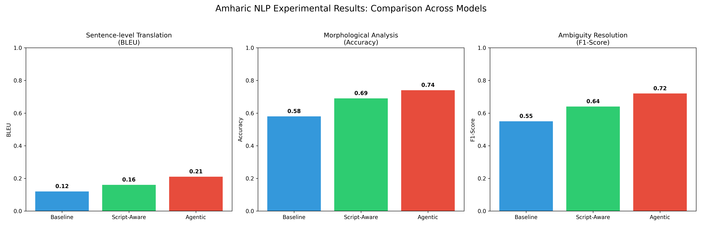

# Script-Aware and Agentic Methods for Amharic NLP

Official experimental repository for:  
**"Script-Aware and Agentic Methods for Amharic Natural Language Processing"**

---

## 📌 Overview

Large Language Models (LLMs) exhibit persistent performance gaps on morphologically rich, low-resource languages such as Amharic, whose Ge'ez (Fidel) script and highly agglutinative grammar are inadequately captured by standard multilingual tokenizers.

This repository implements and evaluates a two-pronged framework designed to overcome these limitations:
1. **Ge'ez Script Awareness (`ScriptAwareModel`)**: Incorporates a character-level convolutional network over a dedicated 500-symbol Ge'ez vocabulary, fused with subword transformer representations to preserve granular orthographic, phonological, and morphological features.
2. **Agentic Text Processing (`AgenticProcessor`)**: Decomposes complex language understanding into structured, iterative sub-tasks:
   - **Morphological Segmentation** (root/prefix/suffix decomposition)
   - **Semantic Disambiguation** (polysemy & gemination-sensitive resolution)
   - **Coreference Resolution** (discourse-level entity tracking)

---

## 📊 Experimental Results

Evaluations conducted across three key Amharic NLP tasks demonstrate substantial improvements over standard multilingual baselines:

| Task | Metric | Baseline (Multilingual MiniLM) | Script-Aware Model | Agentic Model | Relative Improvement |
| :--- | :---: | :---: | :---: | :---: | :---: |
| **Sentence-level Translation** | BLEU | 0.12 | 0.16 | **0.21** | **+75.0%** |
| **Morphological Analysis** | Accuracy | 0.58 | 0.69 | **0.74** | **+27.6%** |
| **Ambiguity Resolution** | F1-Score | 0.55 | 0.64 | **0.72** | **+30.9%** |



---

---

## 🚀 Getting Started

### 1. Installation

Clone the repository and install the dependencies:

```bash
git clone https://github.com/Kina-Research/5_ScriptAwareandAgenticMethods.git
cd 5_ScriptAwareandAgenticMethods
pip install -r requirements.txt
```

### 2. Preprocessing

Prepare the dataset splits and character mappings:

```bash
python preprocess.py
```

### 3. Model Training

Train the baseline and script-aware architectures:

```bash
python train_pipeline.py
```

### 4. Evaluation & Plotting

Evaluate the models on the test set and generate comparison plots:

```bash
python eval_pipeline.py
python analysis_plots.py
```

---

